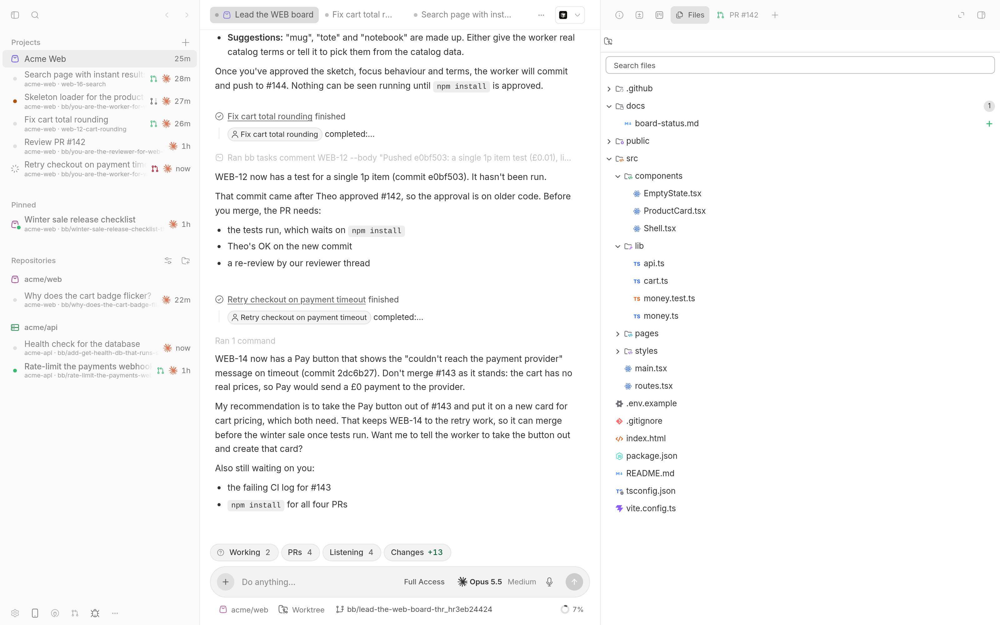
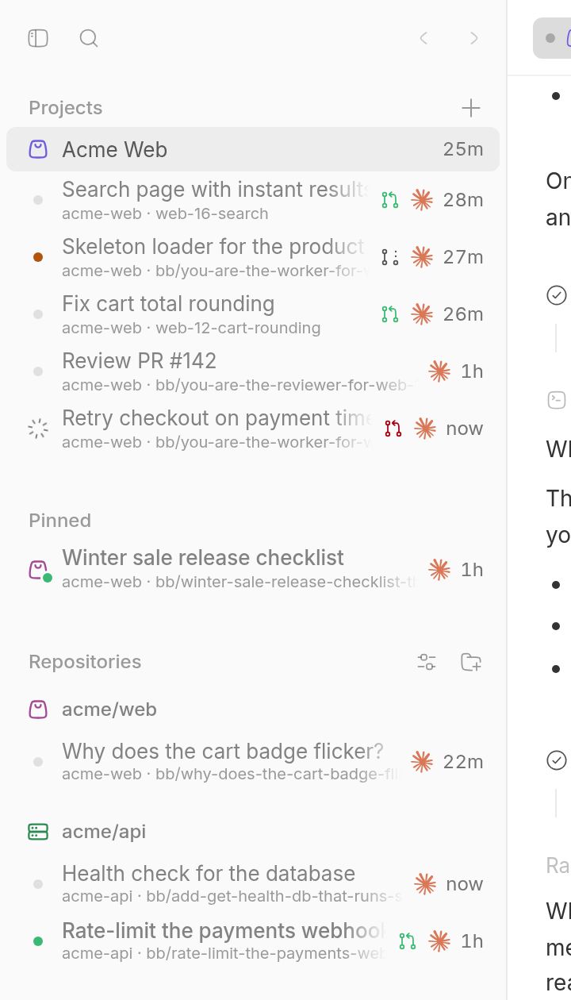
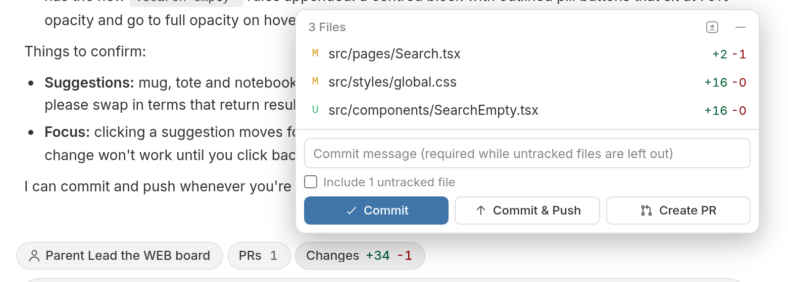
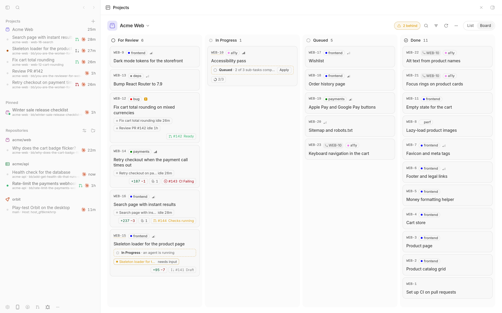
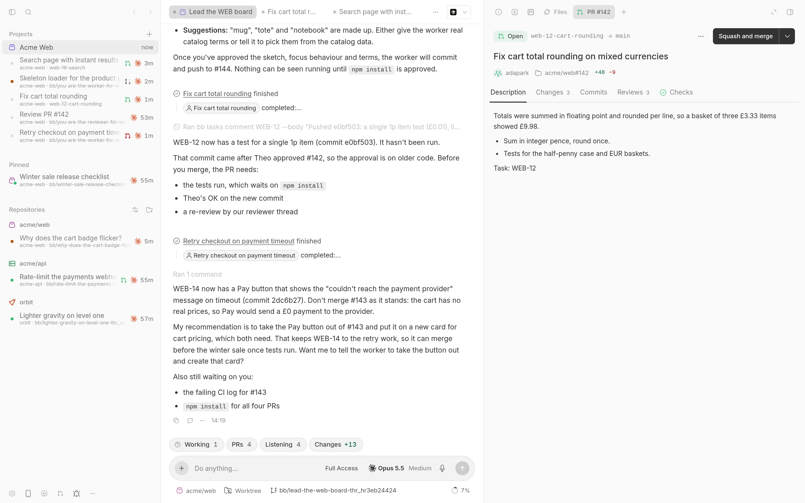
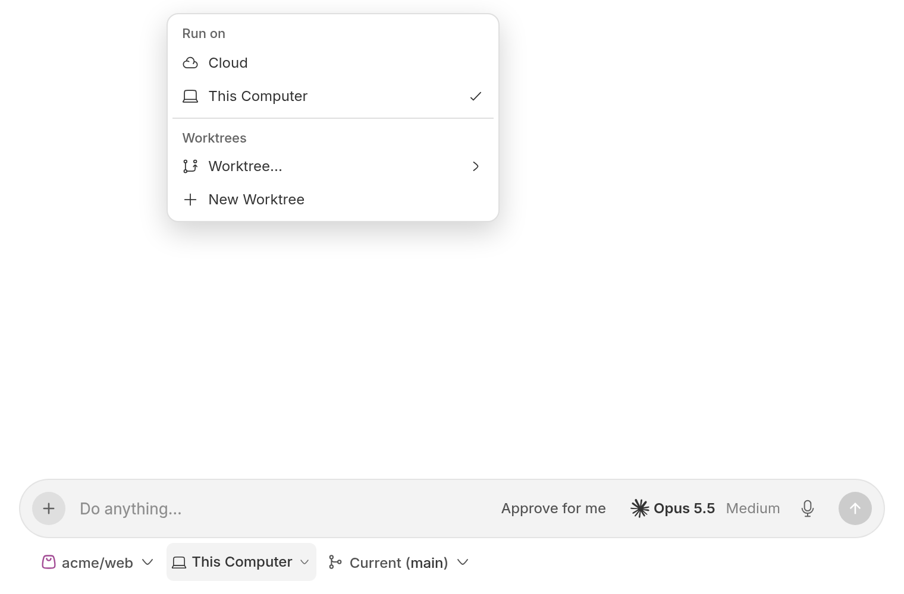
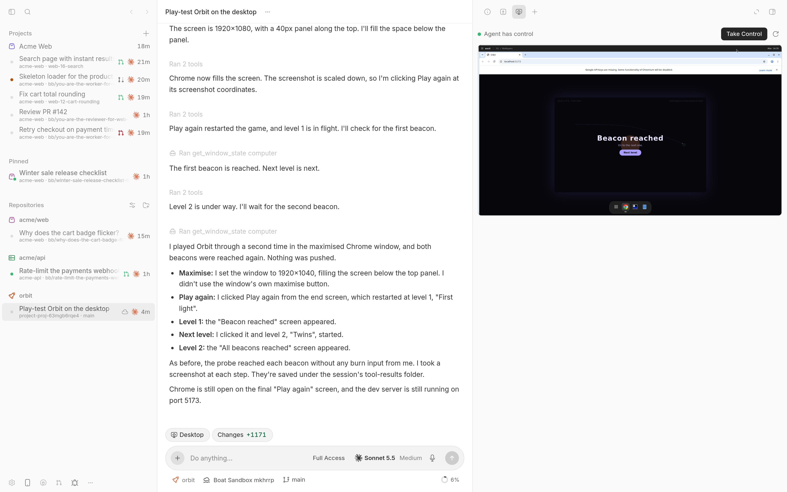

# BB Cursor Suite

Run Claude Code, Codex and the other agents BB supports behind a Cursor-style interface. Seven plugins give [BB](https://getbb.app) Cursor's sidebar, composer, file tree, project boards, pull request views and cloud agents with a desktop you can take over, and each one installs and works on its own.



Not affiliated with Anysphere, Inc. Cursor is a trademark of Anysphere, Inc.

## What you get

### [Cursor Sidebar](plugins/cursor-sidebar)

- Child chats nest under the chat that started them, and pinned chats sit in one block.
- Group by project, last update, status, environment or not at all.
- A spinner means an agent is working, an orange dot means it needs you, and a green dot means it finished and you haven't read it.
- Filters by status, age, environment and pull request state.
- Project icons in ten colours, or your own PNG.
- Workers open as tabs of their lead.



### [Cursor Composer](plugins/agent-pills)

- A Cursor-style prompt box with one row of pills above it: agents, changes, to-dos, the queue and the goal.
- Commit, push or open a pull request from the Changes tray.
- Cursor's environment picker: Cloud, This Computer and your worktrees.
- A Desktop pill on cloud threads. Watch the agent's VM, and press Take Control to drive it yourself.



### [Projects](plugins/projects)

- Board and List views over BB Tasks, in Cursor's columns: For Review, In Progress, Queued, Done and Canceled.
- Live cards show their agents, changes, and pull requests with review and CI state.
- Cards flag when they're behind their evidence. The board never marks anything Done by itself.
- A lead thread plans the work, starts workers, answers their questions and brings you the rest.
- You're notified only when a card is Done or needs you in For Review. Workers stay muted.
- Visible work needs a screenshot before it reaches Done.
- `bb projects` gives agents 16 commands to run the board.



### [Pull Requests](plugins/pull-requests)

- Your GitHub pull requests, grouped by what each one needs from you.
- A full pull request page beside the thread: diffs, checks, reviews and merge.
- One-click hand-offs start an agent to review, fix CI, address feedback or resolve conflicts.
- Threads can follow pull requests and get one message when they change.
- GitLab merge requests for a thread's branch, read-only.



### [Files](plugins/filetree)

- A read-only file tree in the right panel, with search and Git status.
- Files open in the other pane when the panel is split, so the tree stays in view.

### [Boat Sandbox](plugins/machine-boat) (experimental)

- Each cloud agent gets its own [boat.dev](https://boat.dev) VM: Ubuntu, Docker, Chrome, and Claude Code and Codex preinstalled.
- A real desktop the agent can use with computer-use tools, and that you can take over.
- Agent logins come from your boat account, not BB.
- Idle suspend, an auto-stop that runs even if BB is down, a VM limit and a monthly cap. A small VM is $0.018 an hour.

### [UI Tweaks](plugins/ui-tweaks)

- Icon packs, a clearer type hierarchy, prompt placement, Open With filtering and Alt+1 to Alt+9 for right panel tabs.

`packages/suite-shared` holds the contracts, time formatting, settings kit, git safety and design tokens the plugins share. Release tags carry a vendored copy, so a plugin installed from Git never needs the rest of the repository.

## Install

Add the suite's marketplace and install from the store:

```sh
bb marketplace add git:github.com/wy3z/bb-cursor-suite@main --subdirectory marketplace
```

Or install one plugin straight from Git. Each plugin has its own tags, `<id>/vX.Y.Z`:

```sh
bb plugin install git:https://github.com/wy3z/bb-cursor-suite.git@^0.3.4 --plugin cursor-sidebar --tag-prefix cursor-sidebar/
bb plugin install git:https://github.com/wy3z/bb-cursor-suite.git@^1.0.0 --plugin agent-pills --tag-prefix agent-pills/
bb plugin install git:https://github.com/wy3z/bb-cursor-suite.git@^1.0.0 --plugin filetree --tag-prefix filetree/
bb plugin install git:https://github.com/wy3z/bb-cursor-suite.git@^1.0.0 --plugin projects --tag-prefix projects/
bb plugin install git:https://github.com/wy3z/bb-cursor-suite.git@^1.0.0 --plugin pull-requests --tag-prefix pull-requests/
bb plugin install git:https://github.com/wy3z/bb-cursor-suite.git@^0.30.1 --plugin ui-tweaks --tag-prefix ui-tweaks/
bb plugin install git:https://github.com/wy3z/bb-cursor-suite.git@^0.1.0 --plugin machine-boat --tag-prefix machine-boat/
```

Cursor Composer, Files, Projects and Pull Requests are on 1.x. Boat Sandbox is experimental and starts at 0.1.x; its caret range only follows patch releases until it reaches 1.0. Cursor Sidebar stays on 0.3.x and UI Tweaks on 0.30.x, so the installs already out there keep getting updates: moving them to a new range means a reinstall, which deletes their settings.

Installs of Cursor Sidebar from `bb-plugin-cursor-sidebar` on a `^0.3.x` range keep updating from the root-level `vX.Y.Z` tags on the `legacy/cursor-sidebar` branch. UI Tweaks keeps publishing to `wy3z/bb-plugin-ui-tweaks`.

## Cloud agents

On a new thread, Cursor Composer's environment picker sits under the prompt box. Like Cursor's, it offers **Cloud**, **This Computer** and the worktree options. Cloud runs the thread on a machine that a machine provider plugin creates, with a fresh clone of the project, so the work carries on while your computer sleeps.



Cloud lists every environment provider that runs on a machine provider, the ones with a `machineProviderId` in `bb environment providers --json`. BB includes one, Modal Sandbox (experimental), which needs a Modal account. This suite adds [Boat Sandbox](plugins/machine-boat), which runs each thread on its own [boat.dev](https://boat.dev) VM with a desktop, Docker, Chrome, and Claude Code and Codex preinstalled. With no cloud provider installed, Cloud is shown greyed out with a link to this section. When a cloud provider is installed but can't run the current project (`bb environment providers --project <id> --json` leaves it out), Cloud says "Cloud isn't available for this project" instead.

Choosing Cloud only changes the selection. A machine starts when you send the first message. What it costs, and for how long, depends on the provider, so check its pricing.

### The Desktop tab

When a thread runs on a VM with a desktop (Boat Sandbox today), a **Desktop** pill appears above the composer. It opens the VM's screen in the right-hand panel, so you can watch the agent drive Chrome or any other app with its computer-use tools. Press **Take Control** to click and type in it yourself; the agent's computer tools wait until you **Release control**, and an agent that was mid-turn is told to take a fresh screenshot before it carries on.



### Choosing a machine

The picker takes over BB's own Environment button only when one machine is connected and the selection is on this computer. With a second machine connected, or another machine selected, BB's picker stays so you can still choose the machine, and Cursor's picker sits in the prompt box beside it.

## For agents

Each plugin's `PLUGIN_OVERVIEW.md` lists every `bb` CLI command, agent tool, RPC method and setting it adds, with arguments, output and an example. Files, Projects and Pull Requests also ship a skill under `skills/`. [packages/suite-shared/README.md](packages/suite-shared/README.md) documents the shared modules.

## Development

Node 22 or newer, npm, bun (for the bun test suites) and the `bb` CLI on PATH.

```sh
npm ci
npm run check            # typecheck, test and build every workspace changed since origin/main
npm run check:all        # the same for every workspace
npm run suite -- test projects pull-requests
npm run suite -- reload  # reload changed plugins whose live install points into this checkout
```

Each step runs in its own `systemd-run --user --scope` with a 2 GB memory cap when systemd is available (`SUITE_NO_GUARD=1` turns that off). Changes under `packages/suite-shared` also check every plugin that depends on it.

Work in worktrees under `.worktrees/` and keep this checkout on `main`: live path installs load from it.

## Release

```sh
npm run release -- <plugin-id> <x.y.z>
```

The script bumps the plugin's version on the current branch, writes a release commit with `packages/suite-shared` vendored into `plugins/<id>/vendor/bb-suite` when the plugin uses it, and tags that commit `<id>/vX.Y.Z`. For `cursor-sidebar` and `ui-tweaks` it also adds the root-level legacy commit and tag. Nothing is pushed unless you pass `--push`; otherwise it prints the push commands. Never move a published tag.

Before it changes anything, the script runs `npm run versions` with the new version and refuses to release when:

- Cursor Composer, Files, Projects or Pull Requests would drop below 1.0.0.
- Cursor Sidebar or UI Tweaks would leave its legacy stream (`^0.3.2`, `^0.30.0`). Ending a stream on purpose means removing it from `legacyStreams` in `scripts/versions.mjs`.
- The range in `marketplace/marketplace.json` would never offer the new version, or an install or marketplace line in this README or any plugin README disagrees with it.
- A plugin depends on `@wy3z/bb-suite` with anything but `file:../../packages/suite-shared`, or lists it as a peer, optional or bundled dependency. Any of those would send BB's install to the public npm registry.
- `package-lock.json` has a stale version.

It also refuses a downgrade, and any version at or below one already tagged on origin (or on the legacy stream's remote). It then runs the install check below on the exact tree it is about to tag, for the legacy layout too, and only tags if that passes. If it fails, the script drops the version bump commit it made.

`npm run install-check -- <plugin-id>` builds the layout the release would tag, installs it the way BB does (BB's bundled npm with `--prefix`, `--omit=dev` and `--ignore-scripts`, then `bb plugin build`). It checks that `@wy3z/bb-suite` resolved to the vendored copy and that each `dist/*.meta.json` carries the right plugin id and version. Add `--legacy` for the root-level stream, or `--ref <tag>` to check a published tag. CI runs it for every plugin on each pull request and for the tagged plugin on each `<id>/vX.Y.Z` push.

## Licence

MIT, see [LICENSE](LICENSE). Marketplace icons come from [Lucide](https://lucide.dev) (ISC).

---

Not affiliated with, endorsed by or sponsored by Anysphere, Inc. Cursor is a trademark of Anysphere, Inc.
