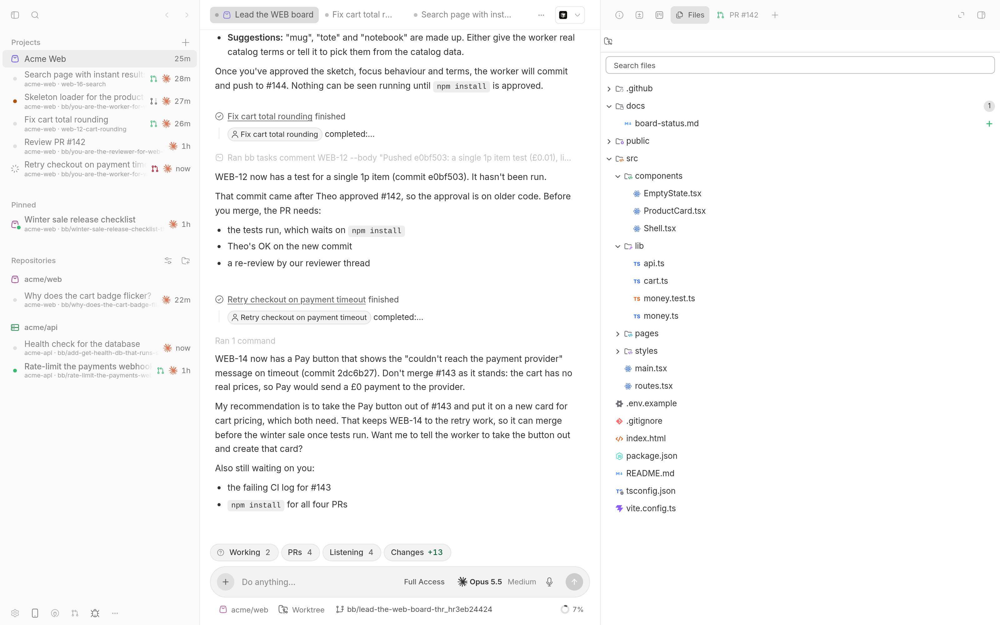
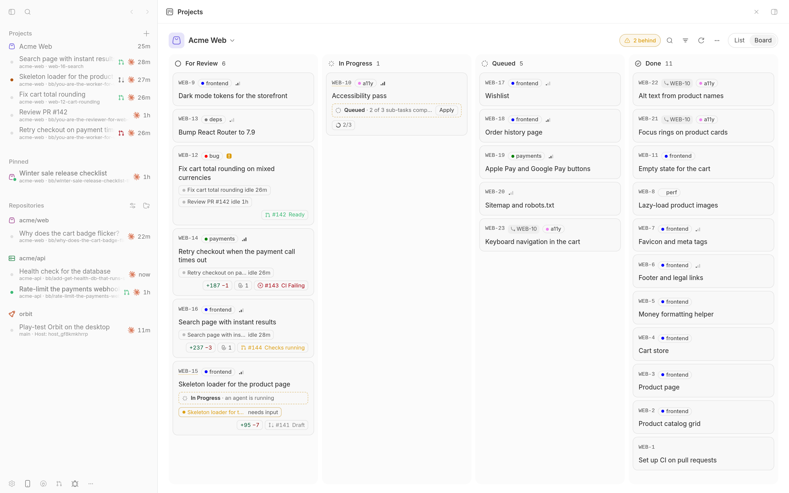
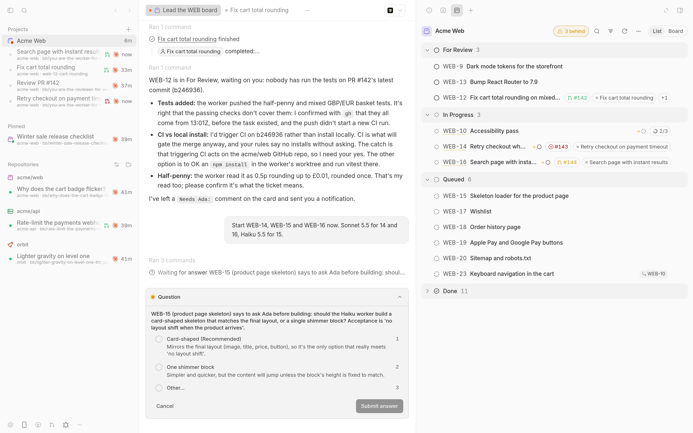
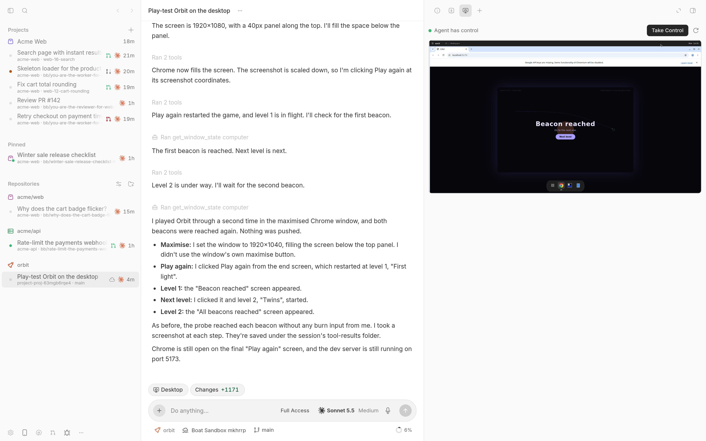

# How I run a whole project from one lead thread

*Part 1 of 2. Part 2 is the UI tour.*

Running more than a few agents at once gets messy fast. Chats on the same files. A question waiting since lunch. A PR you thought was merged that wasn't.

So I stopped running agents and started running a board. One thread leads it. That thread plans, starts workers, reads their work, sends it back when it's wrong, and only bothers me when I'm the one who has to act.

This is how that works in [BB](https://getbb.app) with my [BB Cursor Suite](https://github.com/wy3z/bb-cursor-suite): Cursor's agent UI for Claude Code and Codex, open source. Every rule below is backed by a file in the repo, so you can read the actual prompt rather than trust my summary.

The suite itself is built this way. As of 9 November its board has 100 tasks (71 done), the lead thread has 99 child threads, and the repo has 42 merged pull requests, 38 of them in the last two days.

The screenshots come from a demo workspace with invented projects, people and pull requests. The agent turns in them are real.


*The lead (middle) with its workers in the sidebar. One worker is running, one is waiting on me, and the Files tab shows what the lead just wrote.*

## 1. One board, one lead

Everything starts with a board: a tracker project in BB Tasks, shown by the [Projects plugin](https://github.com/wy3z/bb-cursor-suite/tree/main/plugins/projects) in Cursor's five columns (For Review, In Progress, Queued, Done, Canceled).

Then I pick one thread to lead it:

```sh
bb projects lead WEB
```

That thread gets the [projects skill](https://github.com/wy3z/bb-cursor-suite/blob/main/plugins/projects/skills/projects/SKILL.md), the full playbook. It also gets a short block of rules pinned to its instructions, so they survive compaction. You can read that block in [lead-instructions.ts](https://github.com/wy3z/bb-cursor-suite/blob/main/plugins/projects/src/lead-instructions.ts). It's about twenty lines, and it does most of the work in this guide.

My take: the lead should almost never write code. Its job is to keep the board true and keep my attention on what matters. The moment it starts coding, nobody is watching the board.

## 2. One task, one worker, one branch

The lead turns intent into tasks with acceptance criteria. Then it starts a worker for each one as a child thread and attaches the worker to the task in the same turn:

```sh
bb thread spawn --parent-self --new-environment worktree --base-branch main \
  --provider claude-code --model claude-sonnet-5-5 --prompt-file brief.md
bb tasks attach WEB-14 --thread <worker id>
```

Every brief says the same things: which task it serves, what done looks like, a branch named after the task (`web-14-checkout-retry`), a PR into main, and `bb pull-requests link` so the PR shows up on the card. Workers never merge and never touch main.


*Each card shows its agents, their changes, the PR and its checks. Nothing on it is typed by hand.*

## 3. Cheap workers, strong reviewers

I don't run every worker on the biggest model. In the demo, features go to Sonnet, small UI work to Haiku, and reviews to Opus. The models are written down in the project's notes (`bb projects notes`), so the lead picks the same way every session.

The demo shows why the reviewer earns its cost. A Sonnet worker fixed a rounding bug and opened PR #142. The Opus reviewer read the diff against the task and requested changes, because the half-penny test the task asked for was missing. The lead sent the worker back, the worker added the tests, and the lead reported it to me. I didn't touch any of it.

## 4. Write the status with the evidence

The statuses mean something, and the lead writes them in the same turn as the evidence:

- **For Review** only when I have to act, with a comment that starts `Needs Ada:` (my demo name) and says what.
- **In Progress** only while a live thread works on it.
- **Done** only when the work has landed and the lead has checked it.

That one rule kills the stale board. A card can't sit in In Progress for a week because nobody remembered to move it.

## 5. Reconcile, don't trust

The board works out what each card's evidence says and flags the ones that disagree. A merged PR means Done. A running agent means In Progress. Idle agents with an open PR mean For Review. You can see the rules in the [skill's Reconcile section](https://github.com/wy3z/bb-cursor-suite/blob/main/plugins/projects/skills/projects/SKILL.md#reconcile).

```sh
bb projects reconcile WEB
```

The board never writes Done by itself. It shows a "behind" hint and the lead decides. When the evidence is wrong, the lead comments `Holding: <why>` and the card stops nagging.

## 6. No proof, no Done

A worker that changes something visible has to attach a screenshot or a short recording to the task, with fake data only. Backend work attaches test or log output. A visual change reported without proof goes back to the worker.

And when a visible change reaches For Review, the lead downloads the proof and shows it to me inline. I never have to go looking.

"Fixed, looks good" from an agent that never opened a browser is worth nothing.

## 7. Questions go to the right person

Workers ask questions. The lead answers the ones it can and brings me the ones it can't.

In the demo, WEB-15's task said to ask me before building: a card-shaped skeleton or a single shimmer block? The lead didn't guess. It asked me in the thread, with its recommendation first. I clicked one answer and it started the worker with that decision in the brief.


*The lead's question waits in the thread, and the sidebar marks the lead as needing me.*

There's a trap here worth knowing. When a worker is blocked on a question, `bb thread tell` doesn't answer it. The message just queues behind the question. The lead has to answer the question itself with `bb thread interactions answer`. That's in the pinned rules now.

## 8. Workers in the cloud

Some work shouldn't run on my laptop: long jobs, untrusted repos, anything that needs a desktop and a browser. The [Boat Sandbox plugin](https://github.com/wy3z/bb-cursor-suite/tree/main/plugins/machine-boat) runs a thread on a [boat.dev](https://boat.dev) VM with its own checkout and branch. I pick **Cloud** in the composer and the VM is ready in about 15 seconds.

The VM has a real desktop. The agent opens Chrome, clicks through its own app and takes screenshots. I can watch it in the **Desktop** tab, and press **Take Control** to drive it myself while the agent's computer tools wait.


*A Sonnet worker on a boat VM, play-testing the demo game in Chrome. Take Control is top right.*

The lead can start cloud workers itself. The [skill's cloud section](https://github.com/wy3z/bb-cursor-suite/blob/main/plugins/projects/skills/projects/SKILL.md#workers-in-the-cloud) tells it when: I asked for it, the work needs a desktop or a browser, it's long or heavy, or it shouldn't touch my machine. It has to stay inside the caps and say so when it picks one.

It's cheap. The demo VM cost about half a cent. The plugin suspends idle VMs after 15 minutes and refuses new ones past a monthly cap that you set.

## 9. Memory and focus

Two small things keep a lead sharp across sessions:

- `bb projects notes WEB` is the project's memory: conventions, my preferences, traps a worker fell into. The lead reads it at the start of every session and adds a line when it learns something.
- `bb projects focus WEB "..."` is one or two sentences on what matters right now. The lead reads it before planning.

The notes are where policy lives too. Who merges, how, and with whose go is written there, so the lead follows the project's rules rather than its own idea of them.

## Try it

- The suite: [github.com/wy3z/bb-cursor-suite](https://github.com/wy3z/bb-cursor-suite). Install it from the marketplace or one plugin at a time.
- The playbook: [skills/projects/SKILL.md](https://github.com/wy3z/bb-cursor-suite/blob/main/plugins/projects/skills/projects/SKILL.md) and the [pinned lead rules](https://github.com/wy3z/bb-cursor-suite/blob/main/plugins/projects/src/lead-instructions.ts).
- A small example repo to point a cloud worker at: [wy3z/orbit](https://github.com/wy3z/orbit), the game in the screenshots.

In part 2 I'll walk through the UI piece by piece.

*Not affiliated with, endorsed by or sponsored by Anysphere, Inc. Cursor is a trademark of Anysphere, Inc.*
