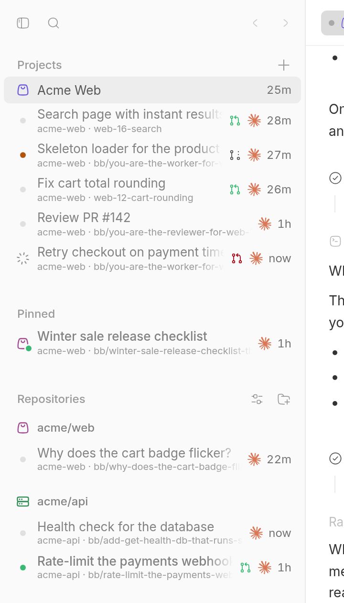
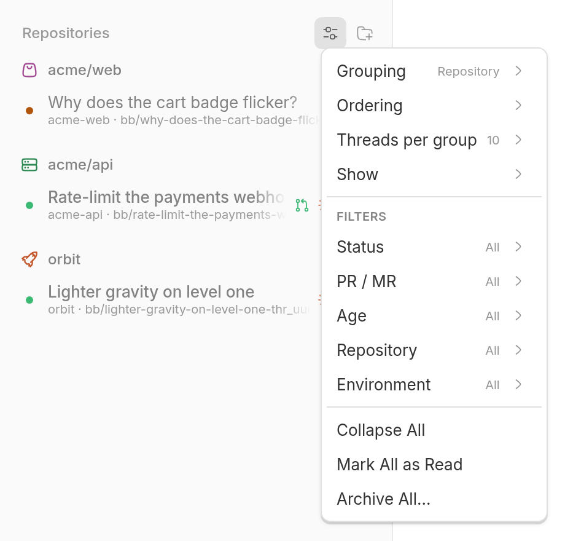
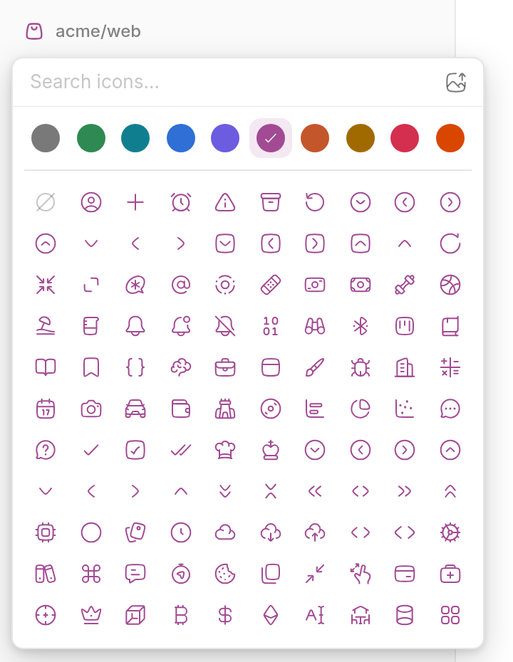
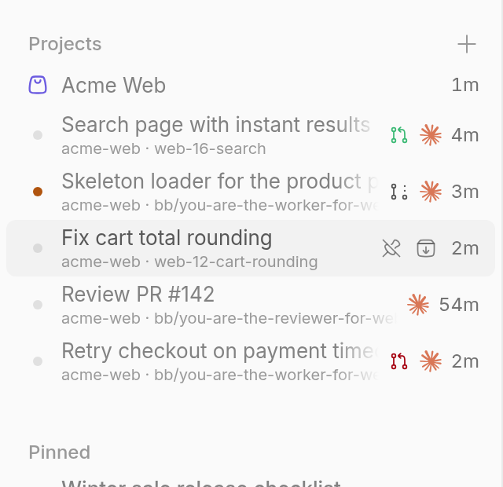
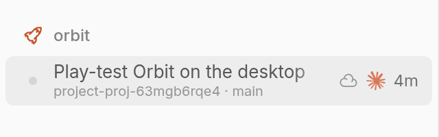

# Cursor Sidebar

Replaces BB's thread list with a port of Cursor's sidebar. Chats nest under the chat that spawned them, pinned chats gather in one block, and you can group everything by project, last update, status, environment or not at all.

## Who it's for

Anyone who runs several agents at once and wants to see, at a glance, which ones are working, which need an answer and which are done. If you use Cursor's sidebar elsewhere, this one will feel familiar.

## What it looks like

- **Five groupings:** Projects, Updated, Status, Environment or None. One at a time.
- **Child chats** sit right under their parent. A parent with working children shows a small count where its age would be.
- **A view menu** for ordering, how many chats each group previews, what each row shows, and filters by status, age, environment and pull request state.
- **A project switcher** that narrows every grouping to one project and opens BB's New project dialog.
- **Workers open as tabs of their lead.** With Projects installed, clicking a worker under a project lead opens it as a tab of the lead, so the lead's side panel stays. Ctrl or Cmd-click still opens a split.
- **Project icons:** a glyph in one of ten colours, or an uploaded PNG. They also replace the folder in BB's composer.
- **Touch gestures** on phones: swipe to pin or archive, hold to drag or open the menu.
- **Two navigation layouts,** Cursor and Compact. Cursor is the default: BB uses the first navigation a plugin adds when you have not picked one, and the plugin registers Cursor first. Any layout you pick in Settings sticks.











Your view settings live in the plugin's own database on the BB server. Uninstalling the plugin removes them and leaves your threads alone.

The full behaviour reference (every menu item, gesture and edge case) is in [PLUGIN_OVERVIEW.md](PLUGIN_OVERVIEW.md).

## Install

```sh
bb marketplace add git:github.com/wy3z/bb-cursor-suite@main --subdirectory marketplace
bb plugin install git:https://github.com/wy3z/bb-cursor-suite.git@^0.3.4 --plugin cursor-sidebar --tag-prefix cursor-sidebar/
```

To install the whole suite instead:

```sh
bb marketplace add git:github.com/wy3z/bb-cursor-suite@main --subdirectory marketplace
for p in cursor-sidebar agent-pills filetree projects pull-requests ui-tweaks machine-boat; do bb plugin install "$p@bb-cursor-suite"; done
```

Needs BB 0.49 or newer with plugin SDK 0.6.132 or newer. It fills BB's experimental thread-list slot. Turn it off with `bb plugin disable cursor-sidebar`.

To go back to BB's own navigation, pick **Rail** or **Top list** under Settings → Appearance → Navigation, or run:

```sh
bb settings ui set sidebar.navigationProvider navigation/rail
```

## For agents

Agents can set a project's icon with `bb cursor-sidebar icon`. That command, the plugin's RPC methods and its realtime channels are documented in [PLUGIN_OVERVIEW.md](PLUGIN_OVERVIEW.md#for-agents).

## Development

```sh
npm run typecheck          # tsc --noEmit
npm run build              # bb plugin build writes dist/
bb plugin reload cursor-sidebar
```

Keep the backend out of the app bundle. Frontend modules take realtime channel names from `src/channels.ts` and may only `import type` from `src/server.ts`. A value import of `./server` pulls the backend and its server-only imports into `app.js`.

## Licence

MIT, see [LICENSE](LICENSE). Portions adapted from bb-plugin-thread-inbox and
T3 Code. See [THIRD-PARTY-NOTICES.md](THIRD-PARTY-NOTICES.md).

---

Not affiliated with, endorsed by or sponsored by Anysphere, Inc. Cursor is a trademark of Anysphere, Inc.
