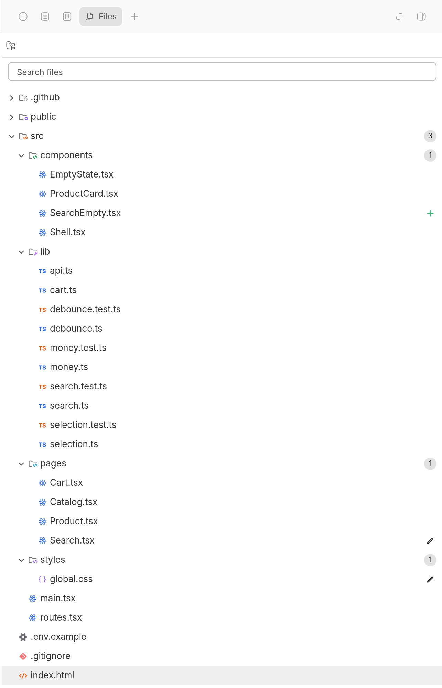
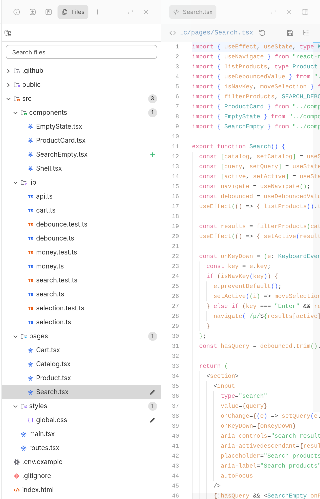

# Files

A file tree for BB's right panel. Browse a thread's workspace and its project's sources, search by path, see Git status at a glance, and open any file in BB's own viewer.

## Who it's for

Anyone who wants to see what an agent is working on without leaving the thread. It is read-only, so it is safe to keep open while agents work.

## What it looks like





- **A Files tab** you add from the right panel's **+** menu in any thread.
- **Workspaces and project sources** in one switcher, with search by path, live updates and keyboard navigation.
- **Git status** on every changed file and folder.
- **Open a file** in BB's viewer as a right panel tab. With the panel split, it opens in the other pane, so the tree stays in view.
- **Copy a path** or **save a copy** of a file from the right-click menu.

File access is read-only. Runs on macOS (Apple silicon and Intel), Linux (x64 and Arm64, glibc 2.29 or newer) and Windows x64. On any other machine the Files tab says it can't browse that machine.

## Install

```sh
bb marketplace add git:github.com/wy3z/bb-cursor-suite@main --subdirectory marketplace
bb plugin install git:https://github.com/wy3z/bb-cursor-suite.git@^1.0.0 --plugin filetree --tag-prefix filetree/
```

Needs BB 0.49 or newer.

## For agents

Agents use `bb files` to list roots, list directories, search paths, read Git status, read text files and prepare downloads. The commands, RPC methods and output shapes are in [PLUGIN_OVERVIEW.md](PLUGIN_OVERVIEW.md#for-agents), and the `files` skill in [skills/files/SKILL.md](skills/files/SKILL.md) teaches them.

## Development

See [docs/development.md](docs/development.md) for building, the native addon and verification.

## Licence

File icons are [Symbols](https://github.com/miguelsolorio/vscode-symbols) by Miguel Solorio (MIT), with slate greys made neutral; see `vendor/symbols`. The bundled document viewers ship their own licences in [THIRD-PARTY-NOTICES.md](THIRD-PARTY-NOTICES.md).

---

Not affiliated with, endorsed by or sponsored by Anysphere, Inc. Cursor is a trademark of Anysphere, Inc.
