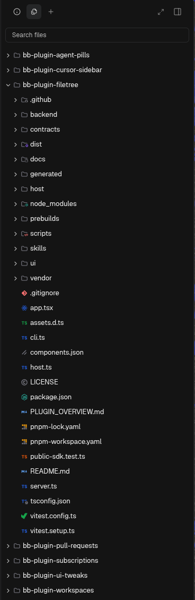

# FileTree

A file tree for BB's right panel.



- Browse workspaces and project sources with search, Git status and live updates.
- Pick a file to open it in BB's own viewer, as a tab in the right panel.
- With the right panel split, files open in the other pane, so the tree stays in view.
- A fixed **Files** tab in every thread's right panel.

File access is read-only.

## Install

```sh
bb marketplace add git:github.com/wy3z/bb-cursor-suite@main --subdirectory marketplace
bb plugin install git:https://github.com/wy3z/bb-cursor-suite.git@^1.0.0 --plugin filetree --tag-prefix filetree/
```

Requires BB 0.49+. Runs on macOS (Apple silicon and Intel), Linux (x64 and Arm64, glibc 2.29 or newer) and Windows x64. On any other machine the Files tab says it can't browse that machine.

[Development and CLI](docs/development.md)

File icons are [Symbols](https://github.com/miguelsolorio/vscode-symbols) by Miguel Solorio (MIT), with slate greys made neutral; see `vendor/symbols`. The bundled document viewers ship their own licences in [THIRD-PARTY-NOTICES.md](THIRD-PARTY-NOTICES.md).

---

Not affiliated with, endorsed by or sponsored by Anysphere, Inc. Cursor is a trademark of Anysphere, Inc.
