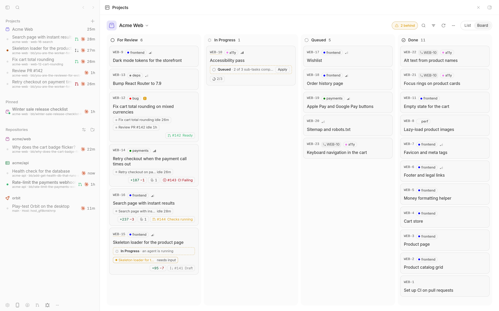
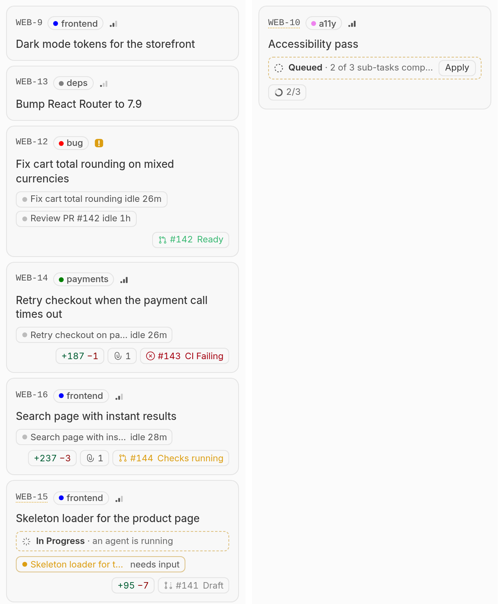
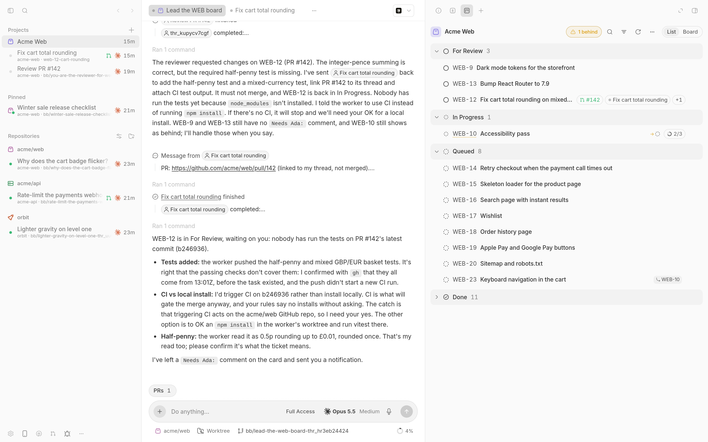
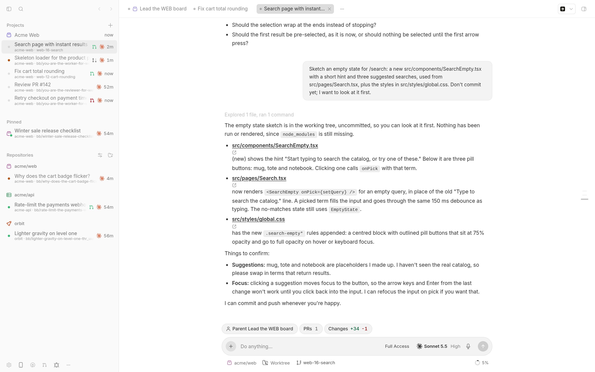
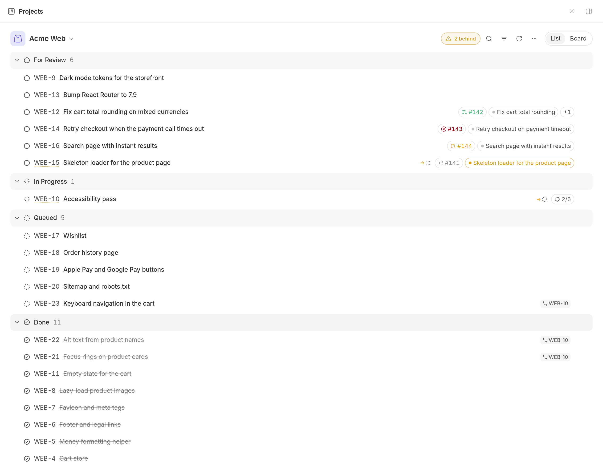

# Projects

Cursor-style project boards for BB, built on BB's own Tasks plugin. Every card shows its live agents, pull requests and changes, and a lead thread can keep the board true for you.

## Who it's for

People who hand real work to agents and need to see where it stands: what is running, what is waiting on review, and what has quietly stalled. Tasks keeps the data; this plugin is the board, the live cards and the project lead workflow.

## What it looks like

- **Board and List views** of a tracker project, in Cursor's order: For Review, In Progress, Queued, Done and Canceled (hidden by default). Drag cards between and within columns, and filter by title or key.
- **Live cards** with labels, priority, a chip for every agent and its live time, the agent's changes, pull request chips with review and CI state, sub-task progress, attachments, and the commit that landed the work.
- **Derived status.** Each card works out what its evidence says (a merged PR, a running agent, an idle agent with an open PR) and shows a "behind" hint when the stored status disagrees. The board never writes Done itself.
- **A card menu** to delegate to any Tasks preset, apply an agent's worktree locally, create a pull request or open the task in Tasks.
- **A project lead:** a thread you nominate to plan, delegate and report. It gets the `projects` skill and a short block of rules pinned to its instructions.
- **Lead tabs.** Workers open as tabs of their lead. Ctrl+Alt+1 to 8 picks the Nth tab and Ctrl+Alt+9 the last, even while you type in the composer.
- **The loop:** an optional scheduled board sweep, pings when cards drift from their evidence, and following every pull request the lead's workers link.
- **Outer-loop messages:** any agent system can hand the lead work with `bb projects send` and read its replies, with nothing lost across restarts.
- **Board icons,** using the suite's port of Cursor's icon picker. Its notices (Hugeicons, T3 Code) are in [suite-shared's THIRD-PARTY-NOTICES.md](../../packages/suite-shared/THIRD-PARTY-NOTICES.md).
- **A composer pill** in any thread of a linked BB project, with the working count and "N for review".











The full behaviour reference is in [PLUGIN_OVERVIEW.md](PLUGIN_OVERVIEW.md).

## Install

```sh
bb marketplace add git:github.com/wy3z/bb-cursor-suite@main --subdirectory marketplace
bb plugin install git:https://github.com/wy3z/bb-cursor-suite.git@^1.0.0 --plugin projects --tag-prefix projects/
```

Needs BB 0.49 or newer, plugin SDK 0.6.132 or newer, and the built-in Tasks plugin enabled. Apply locally and Create PR also need the Pull Requests plugin; without it they stay in the card menu, disabled and marked "Needs Pull Requests".

## For agents

`bb projects` has 16 commands: board status, focus, icons, the lead, notes, the loop, reconcile and the outer-loop mailbox. Every command, option and output shape is in [PLUGIN_OVERVIEW.md](PLUGIN_OVERVIEW.md#for-agents). Lead threads should load the `projects` skill in [skills/projects/SKILL.md](skills/projects/SKILL.md).

## Development

```sh
npm install
npm run typecheck
npm run build
bb plugin install path:$PWD --yes
bb plugin reload projects
```

## Licence

MIT, see [LICENSE](LICENSE).

---

Not affiliated with, endorsed by or sponsored by Anysphere, Inc. Cursor is a trademark of Anysphere, Inc.
