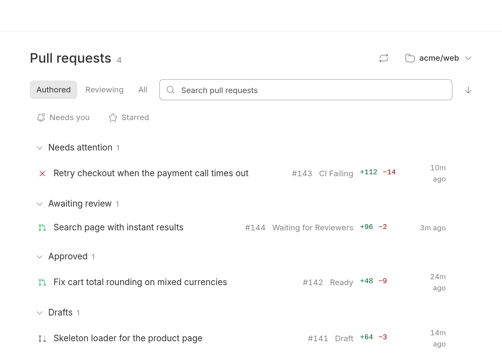
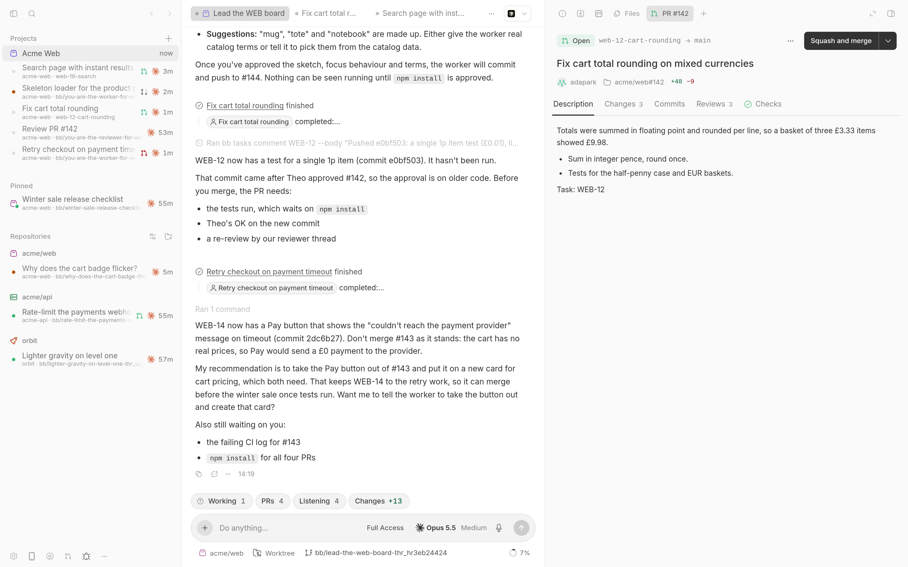
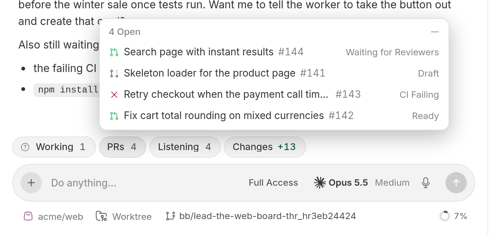

# Pull Requests

Your GitHub pull requests in BB, grouped by what each one needs from you. Open any of them beside a thread to read checks, diffs and the conversation, then hand the work to an agent.

## Who it's for

People whose agents open pull requests and who would rather review them next to the thread that wrote them than in another tab. It uses the `gh` CLI you are already signed in to. GitLab merge requests for a thread's branch are shown read-only.

## What it looks like







- **A board** for one repository at a time, opened from the **Pull requests** button in the sidebar footer. Authored, Reviewing and All views, search, sorting, and Needs you and Starred filters.
- **A page for each pull request** with status, checks, an assessment, the description, every changed file as a diff, and the conversation with inline review threads. Comment, rename, mark ready, merge, close or reopen from there.
- **Hand-offs** that start a new thread to review the PR, address feedback, fix failing checks or resolve conflicts. The prompt waits in the composer for you to read first.
- **A PRs tray** above every composer with the thread's pull requests, its children's, and the branch's own.
- **Live links:** any GitHub pull request link in a message gets a status icon and a hover card.
- **Subscriptions:** a thread can follow pull requests and get one message when they change. A **Listening** chip shows what it follows.
- **Git actions** for the other suite plugins: commit, push, create PR and apply locally.
- **GitLab merge requests** for a thread's branch, read through `glab` on the environment's machine.

The full behaviour reference, including exactly which git commands run and with what protection, is in [PLUGIN_OVERVIEW.md](PLUGIN_OVERVIEW.md).

## Install

```sh
bb marketplace add git:github.com/wy3z/bb-cursor-suite@main --subdirectory marketplace
bb plugin install git:https://github.com/wy3z/bb-cursor-suite.git@^1.0.0 --plugin pull-requests --tag-prefix pull-requests/
```

Needs BB 0.49 or newer and `gh` on the BB server's machine, signed in to github.com (`gh auth login`). The active account is the one used; `gh auth switch` changes it.

To keep one pull request pill above the composer, turn off GitHub PR Status's own:

```sh
bb plugin config bb--github-pr-status set showPullRequest false
```

That also drops its Mark ready and Merge buttons above the composer. Set it back to `true` to restore them.

## For agents

Agents link pull requests to their thread with `bb pull-requests link` and follow them with `bb pull-requests subscribe` or the `pull_request_subscriptions` tool. Every command, the tool and the RPC methods are in [PLUGIN_OVERVIEW.md](PLUGIN_OVERVIEW.md#for-agents), and the `pull-requests` skill in [skills/pull-requests/SKILL.md](skills/pull-requests/SKILL.md) teaches them.

## Develop

```sh
npm install
npx tsc --noEmit -p .
npm test
bb plugin build
bb plugin install . --yes   # first time; then: bb plugin reload pull-requests
```

## Licence

MIT, see [LICENSE](LICENSE). Code ported from Zeron, and project icons from
T3 Code; both notices are in
[THIRD-PARTY-NOTICES.md](THIRD-PARTY-NOTICES.md).

---

Not affiliated with, endorsed by or sponsored by Anysphere, Inc. Cursor is a trademark of Anysphere, Inc.
